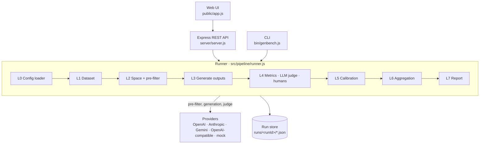
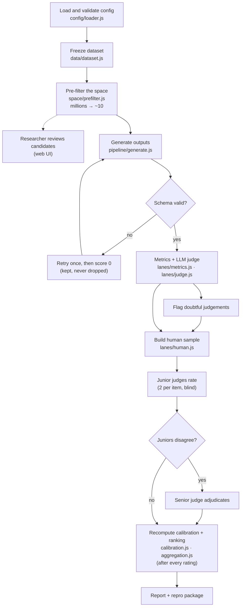

# GenBench code flow

The full design document lives in [DESIGN.md](DESIGN.md). This page shows the architecture and the flow of one run.

## Architecture

## One run

## Calibration gates (Layer 5)

| Check | Statistic | If it fails |
| --- | --- | --- |
| Junior–junior agreement per criterion | Quadratic weighted kappa ≥ `human.agreement_threshold` | Loop-back **A**: rewrite unclear rubric anchors; judge used provisionally |
| Judge–gold agreement per criterion | Quadratic weighted kappa ≥ `calibration.judge_human_threshold` | Criterion scored from human gold; loop-back **B**: fix judge prompt/model |
| Heuristic metric vs gold | Spearman ρ ≥ `calibration.metric_human_threshold` | Metric demoted to diagnostic, removed from ranking |

## Module map

| Module | Responsibility |
| --- | --- |
| `src/config/loader.js` | Load YAML/JSON, defaults, validation, SHA-256 hash |
| `src/data/dataset.js` | Items, image/audio to base64, strata, split by source, dataset hash |
| `src/space/space.js` | Space size, mixed-radix decoding, constraints, seeded sampling |
| `src/space/prefilter.js` | LLM planner, heuristic fallback, diversity-preserving selection |
| `src/providers/index.js` | OpenAI, Anthropic, Gemini, OpenAI-compatible, mock; cost |
| `src/providers/mocksim.js` | Offline models, heuristic judge, simulated raters (demo only) |
| `src/pipeline/generate.js` | Prompts, calls, JSON extraction, schema, retry, provenance, blinding |
| `src/lanes/metrics.js` | Item- and candidate-level metrics |
| `src/lanes/judge.js` | Judge prompt, validation, consistency re-score, flags |
| `src/lanes/human.js` | Sampling with inclusion probabilities, junior/senior queues, gold scores |
| `src/pipeline/calibration.js` | Agreement, score-source map, demotion, bias checks |
| `src/pipeline/aggregation.js` | Normalisation, weights, cluster bootstrap, Holm, ties, sensitivity |
| `src/pipeline/runner.js` | Orchestration, report, repro package |
| `server/server.js` | REST API |
| `public/app.js` | Front-end |
